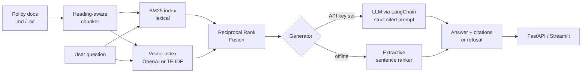

# 📚 Enterprise RAG Assistant

**Citation-grounded question answering over internal policy documents, with hybrid retrieval and a built-in evaluation harness.**

[](https://github.com/silverlookz/enterprise-rag-assistant/actions)     

Banks and other regulated enterprises have thousands of pages of policy (credit, AML, data retention, expenses) that staff need answers from fast and *accurately*. This project shows the patterns that matter when a RAG system has to be trusted, not just demoed:

- **Every answer is cited** back to the source file and section.
- **The system refuses** when the documents don't contain the answer, instead of guessing.
- **Retrieval quality is measured**, not assumed: Hit@k, MRR, groundedness and refusal accuracy run in CI as a quality gate.
- **Runs fully offline** (no API key) for development and testing; switches to OpenAI embeddings + LLM through LangChain when a key is set.

> The sample corpus is a set of *fictional* policies for "Northwind Financial", written for this demo. No real company data is included.

---

## Architecture



| Component | Choice | Why |
|---|---|---|
| Chunking | Heading-aware sliding window (180 words, 40 overlap) | Keeps section titles as citation metadata; overlap avoids cutting facts in half |
| Lexical retrieval | BM25 | Exact policy terms (`GDS`, `LTV`, `10,000 dollars`) matter in finance |
| Dense retrieval | OpenAI `text-embedding-3-small` → TF-IDF fallback | Catches paraphrases; fallback keeps CI free and deterministic |
| Fusion | Reciprocal Rank Fusion (k=60) | Combines rankings without calibrating different score scales |
| Generation | LangChain + `gpt-4o-mini`, temperature 0 | Prompt forbids out-of-context answers and requires `[n]` citations |
| Guardrail | Refusal string + groundedness flag | Downstream apps can block uncited answers |

## Evaluation results (offline mode)

Measured on `data/eval/questions.jsonl` (15 answerable + 2 deliberately unanswerable questions):

| Metric | Score |
|---|---|
| Hit@4 | **1.00** |
| MRR | **1.00** |
| Groundedness | **0.93** |
| Refusal accuracy | **1.00** |

```bash
PYTHONPATH=src python -m rag_assistant.evaluate
```

## Quickstart

```bash
git clone https://github.com/silverlookz/enterprise-rag-assistant.git
cd enterprise-rag-assistant
python -m venv .venv && source .venv/bin/activate
pip install -r requirements.txt

# Ask from the command line
PYTHONPATH=src python -m rag_assistant.pipeline "When must a large cash transaction be reported?"

# REST API (docs at http://localhost:8000/docs)
PYTHONPATH=src uvicorn api.main:app --reload

# Chat UI
streamlit run app/streamlit_app.py
```

To use an LLM, copy `.env.example` to `.env` and set `OPENAI_API_KEY`.

### Example

```
Q: When must a large cash transaction be reported?

A: Cash transactions of 10,000 dollars or more, in a single transaction or multiple
   transactions within 24 hours by the same client, must be reported as a large
   cash transaction within 15 calendar days. [1]

  [1] kyc_aml_standard.md § Transaction Reporting
```

```bash
curl -X POST localhost:8000/ask -H "Content-Type: application/json" \
     -d '{"question": "Can restricted client data be sent to external AI services?"}'
```

## Project structure

```
├── src/rag_assistant/
│   ├── ingest.py      # loading + heading-aware chunking
│   ├── retriever.py   # BM25 + dense retrieval, RRF fusion
│   ├── generator.py   # LLM (LangChain) or extractive answers, citations, refusal
│   ├── pipeline.py    # end-to-end orchestration
│   └── evaluate.py    # Hit@k, MRR, groundedness, refusal accuracy
├── api/main.py        # FastAPI service
├── app/               # Streamlit chat UI
├── data/docs/         # fictional sample policy corpus
├── data/eval/         # labelled evaluation questions
└── tests/             # unit + quality-gate tests (run in GitHub Actions)
```

## Using your own documents

Drop `.md` or `.txt` files into `data/docs/` (or pass `RAGPipeline(docs_dir="path")`), then add questions to `data/eval/questions.jsonl` with the file you expect to be retrieved. Set `expected_source` to `null` for questions that *should* be refused.

## Production considerations

What I'd add before deploying this inside an enterprise:

- **Access control at retrieval time:** filter chunks by the user's entitlements before ranking, so the LLM never sees documents the user can't.
- **Persistent vector store** (pgvector, Azure AI Search, or OpenSearch) with incremental re-indexing on document change.
- **Cross-encoder re-ranking** of the fused top-20 for better precision.
- **Prompt/response audit logging** with retention aligned to records policy.
- **LLM-as-judge faithfulness checks** on a sampled share of production traffic.

## License

MIT
